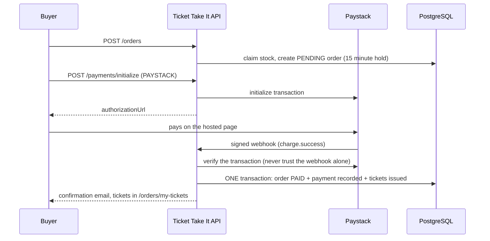

<div align="center">


# Ticket Take It

**Your World. Your Moment.**

A secure event ticketing platform for Kenya: early-bird and group tickets, card and M-Pesa payments, QR tickets and door check-in.

<br />


[Overview](#overview) · [Features](#features) · [Payments](#payments) · [Security](#security) · [API](#api-reference) · [Setup](#getting-started) · [Testing](#testing) · [Deploy](#deployment) · [Roadmap](#roadmap)

</div>

---

## Overview

Ticket Take It solves four problems in event ticketing: **overselling**, **clumsy group bookings**, **insecure payments**, and **fake or reused tickets**.

| Role | Who | What they can do |
| :--- | :--- | :--- |
| **Buyer** (`USER`) | Event-goers | Browse events, buy tickets, pay, hold QR tickets, cancel unpaid orders |
| **Seller** (`SELLER`) | Event organizers | Create and publish events, manage ticket types, see sales and attendees, scan tickets at the door |
| **Admin** (`ADMIN`) | Platform operators | Approve sellers, oversee everything, refund orders, work the refund queue |

> **Status:** the backend is feature-complete and covered by automated tests. The frontend is not built yet. Real money only moves once live payment credentials are configured (see [Deployment](#deployment)).

---

## Features

### Ticket types

| Type | Controlled by | Rule |
| :--- | :--- | :--- |
| **Early bird** | `startsAt`, `endsAt` | Sales fail outside the window |
| **Group** | `minGroupSize`, `maxGroupSize` | Orders outside the limits fail |
| **Regular / VIP** | `price`, `quantity` | Standard inventory |
| **Free** | `priceCents = 0` | The order is paid instantly and tickets are issued at once |

Prices are stored in cents. Kenyan shilling prices must be whole shillings, because M-Pesa cannot charge cents.

### No overselling

Stock is claimed with a single conditional `UPDATE` inside a database transaction. The database rechecks the condition under a row lock, so when two buyers want the last ticket one succeeds and the other is told it sold out. A test fires 25 simultaneous buyers at 10 tickets and checks that exactly 10 succeed.

### Reservations

An unpaid order holds its tickets for 15 minutes, then expires and returns them to stock. Buyers can also cancel an unpaid order. A payment that arrives after expiry still succeeds if the tickets are free, and is queued for refund if they were resold.

### Tickets, QR codes and check-in

Paying an order issues one ticket per person, each with a random 128-bit code for the QR. At the door a seller scans the code and the ticket flips from `VALID` to `USED` exactly once, even if two scanners read it at the same instant. Sellers can scan only their own events.

### Seller tools

Draft, publish, unpublish, edit and cancel events. Add, edit and deactivate ticket types. A dashboard shows sales, revenue, check-in numbers and the attendee list.

### Admin tools

Approve, reject or suspend sellers. Enable or disable accounts. See every event and order. Refund orders, refund a whole cancelled event in batches, and work the refund queue.

### Email

Verification, password reset, order confirmation, refund notices, event-cancellation notices and seller status changes, sent through Resend. Without an API key in development, emails are printed in the terminal instead.

---

## Payments



Every provider (Paystack, M-Pesa, the development mock) ends in the same settlement code, which guarantees:

- **Signed or secret-protected callbacks.** Paystack webhooks are verified with HMAC-SHA512. The M-Pesa callback URL carries a secret.
- **The provider confirms every payment.** The webhook alone never marks an order paid. The app asks Paystack or Safaricom what really happened.
- **Idempotent.** The same event delivered twice, or five times at once, produces one payment and one set of tickets.
- **Amount and currency are checked.** A mismatch is recorded in the refund queue instead of issuing tickets.
- **Nothing is lost.** Duplicate charges, wrong amounts and payments for sold-out tickets all land in `/admin/payments/needs-refund`.
- **Self-healing.** A background job checks pending payments every minute, so a lost webhook never leaves a buyer unpaid.

| Provider | Used for | Refunds |
| :--- | :--- | :--- |
| **Paystack** | Hosted checkout: cards, plus mobile money where enabled on your account | Automatic. Failures stay in the queue with the error and can be retried |
| **M-Pesa (Daraja)** | Direct STK push to the customer's phone | Manual: return the money, then mark it resolved |
| **Mock** | Local testing only. Disabled in production | Manual |

---

## Security

| Layer | Implementation |
| :--- | :--- |
| Passwords | `bcrypt`, 72-byte limit enforced, timing-safe login (the same answer for unknown emails) |
| Sessions | 15-minute access tokens. Refresh tokens are stored hashed, rotate on every use, and a reused token signs the whole session out |
| Accounts | Roles are read from the database on every request, so role changes and disabled accounts apply immediately |
| Validation | `zod` on every body, query and parameter. Unknown keys are stripped |
| Rate limiting | General, strict on auth endpoints, separate for payments. Provider callbacks are exempt |
| Headers and CORS | `helmet`. CORS locked to your frontend |
| Logs | No request headers are logged. Callback secrets are redacted |
| Configuration | The server refuses to start in production with placeholder secrets, and warns about test keys |
| Seeding | The admin password comes from the environment. The seed never promotes an existing account |

---

## API reference

Base URL: `/api/v1`. Successful responses look like `{ "success": true, "data": ... }`, with `meta` for paginated lists.

### Auth `/auth`

| Method | Endpoint | Description | Access |
| :--- | :--- | :--- | :--- |
| `POST` | `/register` | Create an account | Public |
| `POST` | `/login` | Log in | Public |
| `POST` | `/refresh` | Rotate tokens | Public |
| `POST` | `/logout` | Revoke a refresh token | Public |
| `POST` | `/verify-email` | Confirm an email with the link token | Public |
| `POST` | `/resend-verification` | Send the verification email again | Logged in |
| `POST` | `/forgot-password` | Email a reset link | Public |
| `POST` | `/reset-password` | Set a new password with the link token | Public |
| `POST` | `/change-password` | Change password, signs out other devices | Logged in |

### Events and tickets `/events`

| Method | Endpoint | Description | Access |
| :--- | :--- | :--- | :--- |
| `GET` | `/` | Published events (paginated) | Public |
| `GET` | `/:slug` | One event | Public |
| `POST` | `/` | Create a draft event | Approved seller, admin |
| `PATCH` | `/:eventId` | Edit | Owner, admin |
| `POST` | `/:eventId/publish`, `/unpublish`, `/cancel` | Lifecycle | Owner, admin |
| `DELETE` | `/:eventId` | Delete (only if it never had an order) | Owner, admin |
| `GET` | `/:eventId/tickets` | Ticket types on sale | Public |
| `POST` | `/:eventId/tickets` | Add a ticket type | Owner, admin |
| `PATCH` / `DELETE` | `/:eventId/tickets/:ticketId` | Edit, or delete if never ordered | Owner, admin |

### Orders `/orders`

| Method | Endpoint | Description | Access |
| :--- | :--- | :--- | :--- |
| `POST` | `/` | Place an order | Logged in |
| `GET` | `/my-orders` | My orders | Logged in |
| `GET` | `/my-tickets` | My tickets with QR codes | Logged in |
| `GET` | `/:orderId` | One order | Owner, admin |
| `POST` | `/:orderId/cancel` | Cancel an unpaid order | Owner |

### Payments `/payments`

| Method | Endpoint | Description | Access |
| :--- | :--- | :--- | :--- |
| `GET` | `/methods` | Which payment methods are enabled | Public |
| `POST` | `/initialize/:orderId` | Body `{ "provider": "PAYSTACK" }` returns `authorizationUrl`. `{ "provider": "MPESA", "phone": "07..." }` sends a prompt | Owner |
| `GET` | `/status/:orderId` | Poll until `paid` is true or `failureReason` appears | Owner |
| `POST` | `/callbacks/paystack` | Paystack webhook (signature required) | Provider |
| `POST` | `/callbacks/stk/:secret` | M-Pesa callback | Provider |

### Sellers `/sellers`, check-in `/checkin`, users `/users`

| Method | Endpoint | Description | Access |
| :--- | :--- | :--- | :--- |
| `POST` | `/sellers/onboard` | Apply to become a seller (starts as pending) | Logged in |
| `GET` | `/sellers/me` | My seller profile and approval status | Logged in |
| `GET` | `/sellers/events` | My events, drafts included | Seller |
| `GET` | `/sellers/events/:eventId/summary` | Sales, revenue and check-in numbers | Owner, admin |
| `GET` | `/sellers/events/:eventId/attendees` | Attendee list | Owner, admin |
| `GET` | `/sellers/orders` | Orders for my events | Seller, admin |
| `POST` | `/checkin` | Body `{ "code": "..." }` admits a ticket once | Seller, admin |
| `GET` | `/users/me` | My profile | Logged in |

### Admin `/admin`

| Method | Endpoint | Description |
| :--- | :--- | :--- |
| `GET` | `/stats` | Platform totals and revenue per currency |
| `GET` | `/users`, `/sellers`, `/events`, `/orders` | Paginated lists with filters |
| `PATCH` | `/users/:id/status` | Enable or disable an account |
| `PATCH` | `/sellers/:id/status` | Approve, reject or suspend a seller |
| `POST` | `/orders/:id/refund` | Refund an order |
| `POST` | `/events/:id/refund-orders` | Refund every paid order of a cancelled event, 25 per call |
| `GET` | `/payments/needs-refund` | Money that must go back to a customer |
| `POST` | `/payments/:id/retry-refund` | Retry a failed automatic refund |
| `POST` | `/payments/:id/resolve-refund` | Mark a manual refund as done |

---

## Getting started

### Prerequisites

- Node.js 20 or newer
- A PostgreSQL database ([Neon](https://neon.tech) works well)

### 1. Install

```bash
cd backend
npm install
```

### 2. Configure

```bash
cp .env.example .env
```

Fill in `DATABASE_URL` and two long random values for `JWT_ACCESS_SECRET` and `JWT_REFRESH_SECRET`:

```bash
node -e "console.log(require('crypto').randomBytes(48).toString('hex'))"
```

Payment keys are optional while developing. Set `PAYMENT_WEBHOOK_SECRET` to test with the built-in mock provider.

### 3. Create the tables and the first admin

```bash
npx prisma migrate dev
SEED_ADMIN_EMAIL="you@example.com" SEED_ADMIN_PASSWORD="a-long-unique-password" npm run seed
```

Without those two variables, the seed creates a development-only admin (`admin@tickettakeit.com`) and prints a warning. **Never use that account on a deployed database.**

### 4. Run

```bash
npm run dev
```

The API runs at `http://localhost:5000`.

### Trying payments locally

- **Mock:** set `PAYMENT_WEBHOOK_SECRET`, initialize a payment with `{ "provider": "MOCK" }`, then call `POST /payments/webhook` with the header `x-payment-signature`.
- **Paystack:** put a **test** secret key in `PAYSTACK_SECRET_KEY`. Checkout and status polling work without any public URL. For webhooks, run a tunnel such as `ngrok http 5000` and set the webhook URL in the Paystack dashboard.
- **M-Pesa sandbox:** needs a public https `PUBLIC_API_URL` (a tunnel), plus Daraja sandbox credentials.

---

## Testing

The tests run against a real database, because overselling and payment races can only be tested honestly that way.

1. Create a **separate** database whose name contains `test` and set `TEST_DATABASE_URL` in `.env`.
2. Apply the migrations to it with `npx prisma migrate deploy`, with `DATABASE_URL` pointed at the test database for that one command.
3. Run:

```bash
npm test
```

The suite refuses to run if `TEST_DATABASE_URL` is missing, equals your normal database, or its name lacks `test`, because it wipes every table between tests.

| File | What it proves |
| :--- | :--- |
| `orders.test.ts` | 25 simultaneous buyers never oversell, group and early-bird rules, free tickets, expiry and cancel |
| `payments.test.ts` | Webhook security, replays and simultaneous duplicates, wrong amounts, double charges, late payments |
| `paystack.test.ts` | Signed webhooks, Paystack's answer overruling the webhook, status polling, automatic refunds |
| `checkin.test.ts` | One admission per ticket, even under simultaneous scans, and who may scan |
| `refunds.test.ts` | Refunds, the needs-refund queue, event cancellation and bulk refunds |
| `events.test.ts` | Ownership, publishing rules, ticket type rules, protections once tickets are sold |
| `auth.test.ts` | Token rotation and theft detection, reset and verification links, disabled accounts |

---

## Deployment

A suggested setup is the API on Render and the database on Neon.

**Before going live:**

- [ ] Set `NODE_ENV=production`. The server then refuses placeholder secrets.
- [ ] Generate new random `JWT_ACCESS_SECRET` and `JWT_REFRESH_SECRET`, and keep them different.
- [ ] Use Neon's **pooled** connection string for the app. Run migrations with `npx prisma migrate deploy`.
- [ ] Seed the admin with `SEED_ADMIN_EMAIL` and `SEED_ADMIN_PASSWORD`.
- [ ] Point `CORS_ORIGIN` and `APP_URL` at your real https frontend.
- [ ] Verify a domain with Resend, then set `RESEND_API_KEY` and `EMAIL_FROM`.
- [ ] Complete Paystack's business verification, then use the **live** secret key. Set the live webhook URL to `https://<your-api>/api/v1/payments/callbacks/paystack`.
- [ ] If you use M-Pesa directly, finish Safaricom's go-live, set `MPESA_ENV=production`, and use an https `PUBLIC_API_URL`.
- [ ] Leave `ENABLE_MOCK_PAYMENTS` unset. It is off by default in production.
- [ ] Turn on database backups.

---

## Roadmap

- [x] Backend API, payments, refunds, QR tickets, check-in and emails
- [x] Automated test suite
- [ ] **Frontend:** React, Vite and Tailwind v4, built to the design system below
- [ ] Ticket QR images and PDFs attached to emails
- [ ] A job queue for large email batches
- [ ] Automatic M-Pesa refunds

---

## Design system

| Swatch | Name | Hex | Usage |
| :---: | :--- | :--- | :--- |
|  | Deep Black | `#0B0B0D` | Page background |
|  | Charcoal | `#18181B` | Cards, panels |
|  | Cinematic Red | `#E32636` | Primary buttons, active links |
|  | Muted Gold | `#C9A45C` | Premium labels, borders, icons |
|  | Off-white | `#F5F5F5` | Main text |
|  | Muted Gray | `#A1A1AA` | Secondary text |

No emojis in the interface. Use `lucide-react` SVG icons only. High contrast, bento-box grids, Inter or a system sans-serif.

---

<div align="center">

**Ticket Take It** · Your World. Your Moment.

</div>